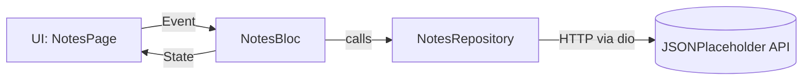

# Notes App (Flutter + Bloc)

A cross-platform mobile notes application built with **Flutter**. It talks to a remote REST API over HTTP and uses **Bloc** for state management.

Mid-term project. Author: Asanbek Turatov.

## Requirements checklist

| # | Requirement | How it is met |
|---|-------------|---------------|
| 1 | Cross-platform mobile app (Flutter) | Flutter / Dart project (`flutter create`), runs on Android; iOS, web and desktop targets are generated too |
| 2 | Mobile app communicates with a server | HTTP requests (GET, POST, PUT, DELETE) via the `dio` package to the [JSONPlaceholder](https://jsonplaceholder.typicode.com) REST API |
| 3 | Pushed to GitHub | This repository |
| 4 | State management (Bloc required) | `flutter_bloc`: `NotesBloc` (events and states) and `ThemeCubit` |

## Features

- Load notes from the server on start
- Create, edit and delete notes
- Mark notes as favorite (favorites are shown first)
- Search by title and text, with a live "found" counter
- Notes counter in the app bar
- Pull-to-refresh
- Delete confirmation dialog
- Error messages in a SnackBar (no connection, server error)
- Theme switcher: system / light / dark (`ThemeCubit`)
- Unit tests for `NotesBloc` and `ThemeCubit`

<!-- Screenshots: put images into a `screenshots` folder, then remove this comment.

## Screenshots

| Notes list | Search | Dark theme |
|------------|--------|------------|
|  |  |  |

-->

## Tech stack

- Flutter, Dart
- [`flutter_bloc`](https://pub.dev/packages/flutter_bloc): state management (Bloc and Cubit)
- [`dio`](https://pub.dev/packages/dio): HTTP client
- [`equatable`](https://pub.dev/packages/equatable): value comparison for states and events

## Architecture

The app is split into layers: UI, Bloc, repository and model.



1. The UI sends an **Event** (for example `AddNote`, `DeleteNote`, `SearchNotes`).
2. `NotesBloc` handles it and calls `NotesRepository` when it needs the server.
3. The repository sends the HTTP request and converts errors into readable messages.
4. The Bloc emits a new **State**; `BlocBuilder` redraws the screen and `BlocListener` shows errors.

The theme is handled separately by `ThemeCubit`, a simplified Bloc without events.

### Project structure

```
lib/
  main.dart                  app entry, providers
  models/note.dart           Note model
  data/notes_repository.dart HTTP requests (dio)
  bloc/
    notes_bloc.dart          NotesBloc
    notes_event.dart         events
    notes_state.dart         state (status, notes, error, search query)
    theme_cubit.dart         ThemeCubit
  ui/notes_page.dart         notes screen and note dialog
test/
  notes_bloc_test.dart       NotesBloc tests
  theme_cubit_test.dart      ThemeCubit tests
```

## API used

Base URL: `https://jsonplaceholder.typicode.com`

| Action | Request |
|--------|---------|
| Load notes | `GET /posts?_limit=15` |
| Create note | `POST /posts` |
| Edit note | `PUT /posts/{id}` |
| Delete note | `DELETE /posts/{id}` |

> **Note:** JSONPlaceholder is a fake API for testing. It accepts requests and returns success, but it **does not store changes**. After the app is restarted, the original list is loaded again. The app updates its own list locally so changes are visible while it is running. Note texts from the server are placeholder (Latin) text.

## Getting started

Requirements: Flutter SDK, Android Studio (Android SDK and emulator) or a connected device.

```bash
git clone https://github.com/asan1402/midterm_app.git
cd midterm_app
flutter pub get
flutter run
```

Run the tests:

```bash
flutter test
```

An internet connection is required, because the notes are loaded from the server.

## Possible improvements

- Persist notes locally (for example with `shared_preferences` or `sqflite`)
- Own backend that really stores notes
- Remember the selected theme between launches
- Authentication and per-user notes
